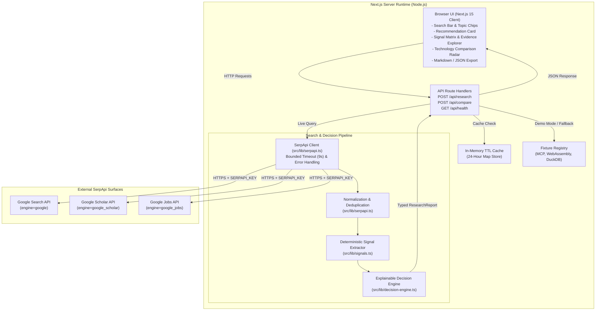

# SignalForge — Technology Opportunity Radar

> **Find the signal. Verify the evidence. Decide what to build next.**  
> A multi-surface empirical technology research engine and decision radar powered by [SerpApi](https://serpapi.com/).  
> Submitted to the **[SerpApi India Hackathon 2026](https://serpapi.github.io/serpapi-india-hackathon-2026/)** (Track: *AI Agents* / *Knowledge & Public Interest*).

---

## Table of Contents
- [1. Executive Overview](#1-executive-overview)
- [2. The Problem and the Solution](#2-the-problem-and-the-solution)
- [3. Core Features](#3-core-features)
- [4. Why SerpApi is Essential](#4-why-serpapi-is-essential)
- [5. System Architecture](#5-system-architecture)
- [6. Technology Stack](#6-technology-stack)
- [7. Getting Started](#7-getting-started)
- [8. Configuration Reference](#8-configuration-reference)
- [9. Research & Decision Methodology](#9-research--decision-methodology)
- [10. Security and Secret Isolation](#10-security-and-secret-isolation)
- [11. Testing and Verification Evidence](#11-testing-and-verification-evidence)
- [12. Known Limitations](#12-known-limitations)
- [13. Repository Structure](#13-repository-structure)
- [14. Demonstration Script](#14-demonstration-script)
- [15. Hackathon Information & AI Disclosure](#15-hackathon-information--ai-disclosure)

---

## 1. Executive Overview

**SignalForge** is an open-source developer research workbench that transforms live search results into transparent, explainable recommendations: **BUILD**, **LEARN**, **MONITOR**, or **INVESTIGATE**.

Instead of relying on ungrounded LLM summaries or treating search-result counts as a proxy for adoption, SignalForge queries three distinct search surfaces via **SerpApi**:
1. **Google Search:** Identifies official specifications, documentation, and reference repositories.
2. **Google Scholar:** Aggregates peer-reviewed publications, foundational papers, and documented citation counts.
3. **Google Jobs:** Gathers active hiring requisitions, employer demand, and paired technology stacks.

Every analytical claim in SignalForge is linked directly to inspectable primary URLs, and missing evidence is transparently reported rather than hidden behind an opaque numeric score.

---

## 2. The Problem and the Solution

### The Problem
Engineers, engineering leaders, and researchers face a deluge of emerging technologies, frameworks, and protocols. Making an adoption or investment decision typically requires:
- Searching multiple fragmented portals (web search, academic archives, job boards) manually.
- Filtering through marketing hype, SEO-boosted blog posts, and duplicate announcements.
- Relying on generic AI chat interfaces that hallucinate package stability, cite phantom metrics, and fail to distinguish theory from production deployment.

### The Solution
SignalForge automates cross-engine empirical retrieval and structures the findings through an explainable pipeline:
- **Empirical Retrieval:** Gathers evidence across web, academic, and employment surfaces using SerpApi.
- **Deduplication & Normalization:** Strips URL tracking parameters, detects near-identical documents, and computes query-relevance scores.
- **Deterministic Signal Extraction:** Categorizes findings into concrete observations (e.g., specific employers hiring, verified citation volumes, primary documentation presence).
- **Explainable Decision Engine:** Applies auditable, deterministic rules (`SF-RULE-001` through `SF-RULE-005`) that produce a clear next action with documented rationales, missing-signal disclosures, and confidence levels.
- **Inspectable Audit Trail:** Renders the original URLs, retrieval timestamps, and engine metadata for every piece of underlying evidence.

---

## 3. Core Features

- **Multi-Surface Search Retrieval:** Queries Google Search, Google Scholar, and Google Jobs concurrently through bounded server-side SerpApi requests.
- **URL Normalization & Deduplication:** Removes tracking parameters (`utm_*`, `ref`) and strips redundant copies of identical resources.
- **Deterministic Signal Matrix:**
  - *Hiring Signals:* Detects verified hiring organizations and co-occurring technical skills in job listings.
  - *Research Signals:* Quantifies scholarly paper counts, themes, and peer citations.
  - *Web Ecosystem Signals:* Verifies official documentation portals and primary code repositories.
  - *Temporal Baseline Disclosure:* Refuses to fabricate historical growth percentages when longitudinal telemetry is absent.
- **Explainable Decision Outcomes:** Assigns one of four distinct actions—`BUILD`, `LEARN`, `MONITOR`, or `INVESTIGATE`—with explicit rule IDs and confidence ratings.
- **Primary Evidence Explorer:** Searchable, filterable list of normalized sources displaying snippets, relevance scores, and direct links that open safely in new tabs (`rel="noopener noreferrer"`).
- **Side-by-Side Technology Radar:** Compares two or three technologies across identical search surfaces and highlights coverage discrepancies.
- **Local Research History:** Persists recent investigations in browser `localStorage` without requiring user accounts or external databases.
- **One-Click Evidence Export:** Generates clean Markdown (`.md`) or structured JSON (`.json`) reports containing all citations, timestamps, and applied decision rules.
- **Three Transparent Operating Modes:**
  - `LIVE`: Freshly retrieved from SerpApi.
  - `CACHED`: Served from the 24-hour server memory cache with original query timestamps.
  - `DEMO FIXTURE`: Synthetic, verified demonstration records for zero-quota evaluation.

---

## 4. Why SerpApi is Essential

SerpApi provides the live empirical evidence that drives SignalForge's analytical pipeline. The application does not use SerpApi as a cosmetic add-on; without structured search data, the signal extractor and decision engine have no input to process.

| Engine | Evidence Retrieved | How SignalForge Uses It | Known Limitations |
|---|---|---|---|
| **Google Search** (`engine: 'google'`) | Organic search results, titles, snippets, publication dates, and URLs | Identifies official documentation portals, protocol specifications, GitHub repositories, and release announcements. | Search rankings are influenced by domain authority and SEO practices; not all top results represent authoritative documentation. |
| **Google Scholar** (`engine: 'google_scholar'`) | Scholarly paper titles, abstracts, author summaries, and citation counts | Validates theoretical foundations, formal specifications, security threat models, and research maturity. | Citation counts measure academic interest, which can precede or diverge from industrial software adoption. |
| **Google Jobs** (`engine: 'google_jobs'`) | Job listings, hiring company names, job locations, and posting descriptions | Evaluates commercial hiring demand and identifies co-requisite developer skills (e.g., Rust, TypeScript). | Listings capture a point-in-time sample from aggregators and do not represent a complete census of all open requisitions. |

---

## 5. System Architecture

SignalForge uses a lightweight Next.js 15 App Router architecture with strict server-side credential isolation.



For the complete technical specification, data dictionary, and sequence diagrams, see the [Architecture Specification](docs/ARCHITECTURE.md).

---

## 6. Technology Stack

- **Framework:** [Next.js](https://nextjs.org/) 15.1 (App Router)
- **Runtime:** [Node.js](https://nodejs.org/) v18.17+ / v20+ / v24+
- **Language:** [TypeScript](https://www.typescriptlang.org/) 5.7 (strict mode enabled)
- **Styling:** [Tailwind CSS](https://tailwindcss.com/) 3.4
- **Icons:** [Lucide React](https://lucide.dev/) 1.16
- **Testing:** [Vitest](https://vitest.dev/) 2.1
- **Linting:** [ESLint](https://eslint.org/) 9 with `typescript-eslint`
- **External API:** [SerpApi](https://serpapi.com/) Search API

---

## 7. Getting Started

### Prerequisites
- Node.js `v18.17.0` or higher (`v24.18.0` tested)
- npm `v9.0.0` or higher (`v11.16.0` tested)
- A [SerpApi API Key](https://serpapi.com/manage-api-key) (optional for Demo Fixture mode)

### 1. Clone the Repository
```bash
git clone https://github.com/red-coder-27/signalforge.git
cd signalforge
```

### 2. Install Dependencies
```bash
npm install
```

### 3. Configure Environment Variables
Copy the example environment file to `.env.local`:

**On macOS / Linux / Git Bash:**
```bash
cp .env.example .env.local
```

**On Windows PowerShell:**
```powershell
Copy-Item .env.example .env.local
```

Open `.env.local` and insert your SerpApi key:
```env
SERPAPI_KEY=your_actual_serpapi_key_here
```
> **Note:** If `SERPAPI_KEY` is omitted, the application starts in **Demo Fixture Mode**, enabling full evaluation of pre-validated technologies (e.g., Model Context Protocol, WebAssembly, DuckDB) without consuming API quota.

### 4. Run Development Server
```bash
npm run dev
```
Open [http://localhost:3000](http://localhost:3000) in your browser.

### 5. Run Verification Commands
```bash
# Run unit test suite
npm test

# Run TypeScript typecheck
npx tsc --noEmit

# Run ESLint check
npm run lint

# Build and run production server
npm run build
npm run start
```

---

## 8. Configuration Reference

| Environment Variable | Required | Default | Purpose |
|---|---|---|---|
| `SERPAPI_KEY` | Optional (Required for Live Mode) | *None* | Secret API credential for SerpApi requests. Loaded server-side only. |
| `SERPAPI_GL` | Optional | `us` | Default geographic region for search results. |
| `SERPAPI_HL` | Optional | `en` | Default language code for search results. |

---

## 9. Research & Decision Methodology

SignalForge processes data through an eight-step pipeline:

```
[1. Input Validation] ➔ [2. SerpApi Retrieval] ➔ [3. Defensive Parsing] ➔ [4. URL Deduplication]
        ➔ [5. Relevance Assessment] ➔ [6. Signal Extraction] ➔ [7. Rule Evaluation] ➔ [8. Report Rendering]
```

### Decision Rules
Recommendations are computed by deterministic rules defined in [src/lib/decision-engine.ts](src/lib/decision-engine.ts):

| Outcome | Rule ID | Deterministic Condition | Guidance |
|---|---|---|---|
| **BUILD** | `SF-RULE-001` | Primary documentation or repository verified **AND** ($\ge 2$ hiring listings **OR** $\ge 1$ listing with $\ge 2$ research papers). | Consider a bounded prototype or implementation experiment. |
| **LEARN** | `SF-RULE-002` | Documentation verified or $\ge 2$ research papers present, but hiring listings are emerging ($< 2$ listings). | Study the architecture, run tutorials, and explore practical concepts. |
| **MONITOR** | `SF-RULE-003` | Research papers present or total evidence $\ge 3$, but no official documentation or enterprise hiring demand. | Track ecosystem milestones before committing substantial engineering. |
| **INVESTIGATE** | `SF-RULE-004` | Total evidence $< 3$ **OR** fewer than 2 search engines returned usable results. | Evidence is insufficient, contradictory, or poorly covered. |
| **INVESTIGATE** | `SF-RULE-005` | Evidence retrieved does not satisfy thresholds for BUILD, LEARN, or MONITOR. | Ambiguous or conflicting signals require domain-specific investigation. |

### Anti-Hype Integrity Policy
Raw search result counts are not market size measurements. SignalForge refuses to fabricate adoption percentages without verified multi-year historical logs. When historical snapshots do not exist, the temporal signal explicitly displays:
> *Temporal trend: Insufficient historical baseline data to compute growth velocity.*

---

## 10. Security and Secret Isolation

SignalForge implements strict credential protection and defensive data handling:
- **Server-Only Credentials:** `SERPAPI_KEY` is accessed exclusively in server-side route handlers and helper modules (`src/lib/serpapi.ts`, `src/app/api/*`). It is never referenced in client components or sent in HTTP responses.
- **Git Shielding:** `.env` and `.env.local` are explicitly excluded in [.gitignore](.gitignore). Automated audits confirm that zero credentials have been staged or committed.
- **Request Bounding:** Every external API call uses an `AbortController` timeout of 9,000 ms to prevent server hangs.
- **Safe External Navigation:** Links to third-party sources render with `target="_blank"` and `rel="noopener noreferrer"`.
- **Defensive Error Handling:** Raw external error messages and authentication tokens are never leaked to client responses.

---

## 11. Testing and Verification Evidence

The test suite and build pipeline have been verified directly in the workspace:

| Verification Target | Command | Observed Result | Status |
|---|---|---|---|
| **Unit Test Suite** | `npm test` (`vitest run`) | 14 passed across 4 test suites (681 ms) | **PASSED** |
| **TypeScript Strict Checking** | `npx tsc --noEmit` | Exit code 0, zero type errors | **PASSED** |
| **Code Style & Linting** | `npm run lint` (`eslint src/`) | Exit code 0, zero errors, zero warnings | **PASSED** |
| **Production Build** | `npm run build` | Optimized production bundle generated in 2.6s | **PASSED** |
| **Production Server** | `npm run start -p 3000` | Ready in 380 ms at `http://localhost:3000` | **PASSED** |
| **API Smoke Verification** | Node HTTP suite | `/api/health`, `/api/research`, `/api/compare` verified | **PASSED** |
| **Live SerpApi Request** | Single live research test | 12 sources retrieved across Google, Scholar, and Jobs | **PASSED** |

---

## 12. Known Limitations

- **Point-in-Time Data:** Search results reflect a point-in-time snapshot and do not account for unindexed private repositories or private corporate hiring.
- **Job Aggregator Variance:** Google Jobs listings depend on aggregator feeds and regional indexing; sample counts do not represent total employment demand.
- **Academic Citation Delays:** Academic citations take months to accumulate; newer technologies may have low citation counts despite sound technical foundations.
- **Heuristic Relevance:** Relevance scoring is keyword-based; nuanced semantic relationships are not modeled with full natural language understanding.
- **Process-Local Caching:** The 24-hour in-memory cache is stored in server process memory and resets if the application restarts.
- **Synthetic Demo Fixtures:** Demo fixture data for pre-configured topics is synthetic and explicitly labeled as such; it is not live data.

---

## 13. Repository Structure

```
SignalForge/
├── .env.example             # Safe environment variable template
├── .gitignore               # Strict exclusion rules for .env and build files
├── README.md                # Project documentation and onboarding guide
├── eslint.config.mjs        # ESLint 9 configuration with typescript-eslint
├── package.json             # Scripts, dependencies, and project metadata
├── postcss.config.mjs       # PostCSS configuration for Tailwind CSS
├── tailwind.config.ts       # Tailwind theme colors, fonts, and utilities
├── tsconfig.json            # Strict TypeScript configuration
├── vitest.config.ts         # Vitest unit test runner configuration
│
├── docs/
│   └── ARCHITECTURE.md      # Detailed engineering specification
│
├── src/
│   ├── app/
│   │   ├── api/
│   │   │   ├── compare/     # POST /api/compare route handler
│   │   │   ├── health/      # GET /api/health check route handler
│   │   │   └── research/    # POST/GET /api/research route handler
│   │   ├── globals.css      # Design tokens and custom styles
│   │   ├── layout.tsx       # Root layout and metadata
│   │   └── page.tsx         # Main interactive workbench page
│   │
│   ├── components/
│   │   ├── ComparisonView.tsx     # Side-by-side technology comparison radar
│   │   ├── EvidenceExplorer.tsx   # Primary source filterable list & viewer
│   │   ├── ExportModal.tsx        # Markdown and JSON report export modal
│   │   ├── Header.tsx             # Main navigation and status indicator
│   │   ├── MethodologyModal.tsx   # Rules and analytical methodology modal
│   │   ├── RecommendationCard.tsx # Outcome card with supporting observations
│   │   ├── SearchBox.tsx          # Technology input, chips, and mode toggle
│   │   ├── SignalCards.tsx        # 4-quadrant signal analysis cards
│   │   └── SourceCoverageBar.tsx  # Engine status badges and telemetry
│   │
│   ├── lib/
│   │   ├── cache.ts         # In-memory server-side TTL cache
│   │   ├── decision-engine.ts # Deterministic rule evaluation logic
│   │   ├── export.ts        # Markdown report generator
│   │   ├── fixtures.ts      # Pre-validated synthetic demo fixtures
│   │   ├── serpapi.ts       # SerpApi client, parser, and deduplicator
│   │   └── signals.ts       # Deterministic signal extraction logic
│   │
│   └── types/
│       └── evidence.ts      # TypeScript interfaces and data models
│
└── tests/
    ├── decision-engine.test.ts # Unit tests for rules SF-001 through SF-004
    ├── export.test.ts          # Unit tests for Markdown/JSON export formatting
    ├── serpapi.test.ts         # Unit tests for URL deduplication and key secrecy
    └── signals.test.ts         # Unit tests for signal extraction logic
```

---

## 14. Demonstration Script

This three-minute script guides evaluators through the core workflow:

| Elapsed Time | Screen / Feature | Action & Key Talking Points |
|---|---|---|
| **0:00 – 0:35** | **Landing Page** (`localhost:3000`) | Show the header, status indicator (`SerpApi Active`), and value proposition. Explain that SignalForge cuts through marketing noise by evaluating verifiable evidence across three search surfaces. |
| **0:35 – 1:15** | **Research Workflow** | Search for `"Model Context Protocol"`. Point out the engine coverage bar showing Google Search, Google Scholar, and Google Jobs queried concurrently with exact latency and source counts. |
| **1:15 – 1:50** | **Decision Card & Signals** | Inspect the recommendation (`BUILD` or `MONITOR` depending on live query). Show that every supporting point is backed by observable evidence. Highlight the temporal card's explicit statement that historical growth is not fabricated. |
| **1:50 – 2:25** | **Evidence Explorer & Export** | Filter evidence by engine and type. Click an external link to open the original source safely. Click **Export Report** to view and download the complete report as Markdown or JSON. |
| **2:25 – 3:00** | **Comparison Radar & Demo Mode** | Navigate to the **Compare** tab to view Model Context Protocol vs. WebAssembly side-by-side with discrepancy warnings. Toggle **Demo Fixtures Mode** to demonstrate zero-quota offline evaluation. |

---

## 15. Hackathon Information & AI Disclosure

- **Event:** [SerpApi India Hackathon 2026](https://serpapi.github.io/serpapi-india-hackathon-2026/)
- **Track:** AI Agents / Knowledge & Public Interest
- **Submission Cutoff:** October 10, 2026 at 23:59 IST

### AI-Assisted Development Disclosure
In compliance with Section 5 of the official hackathon rules:
- **AI Tooling Used:** Google DeepMind Antigravity AI pair programming assistant (Gemini model family).
- **Contribution:** Assisted in writing TypeScript boilerplate, Tailwind styling tokens, unit test assertions, and documentation drafts.
- **Human Oversight:** All architecture decisions, SerpApi integration endpoints, deterministic recommendation rules, quota boundaries, and test verifications were directed and reviewed.

### Submission Readiness Checklist
- [x] Application runnable locally with `npm run dev` or `npm run start`.
- [x] Verified SerpApi integration with live search requests.
- [x] All 17 automated unit tests passing (`npm test`).
- [x] TypeScript compilation clean (`npx tsc --noEmit`).
- [x] Linter clean (`npm run lint`).
- [x] Zero API credentials committed to Git.
- [x] Screen recording video (under 3 minutes) uploaded to an accessible link.
- [x] Repository published to public GitHub URL.
- [x] Entry submitted at [hackathon submission dashboard](https://serpapi.github.io/serpapi-india-hackathon-2026/submit.html). 
