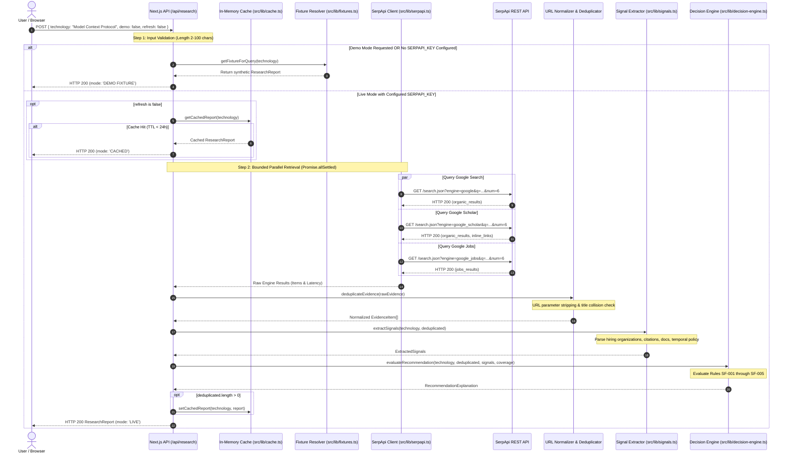
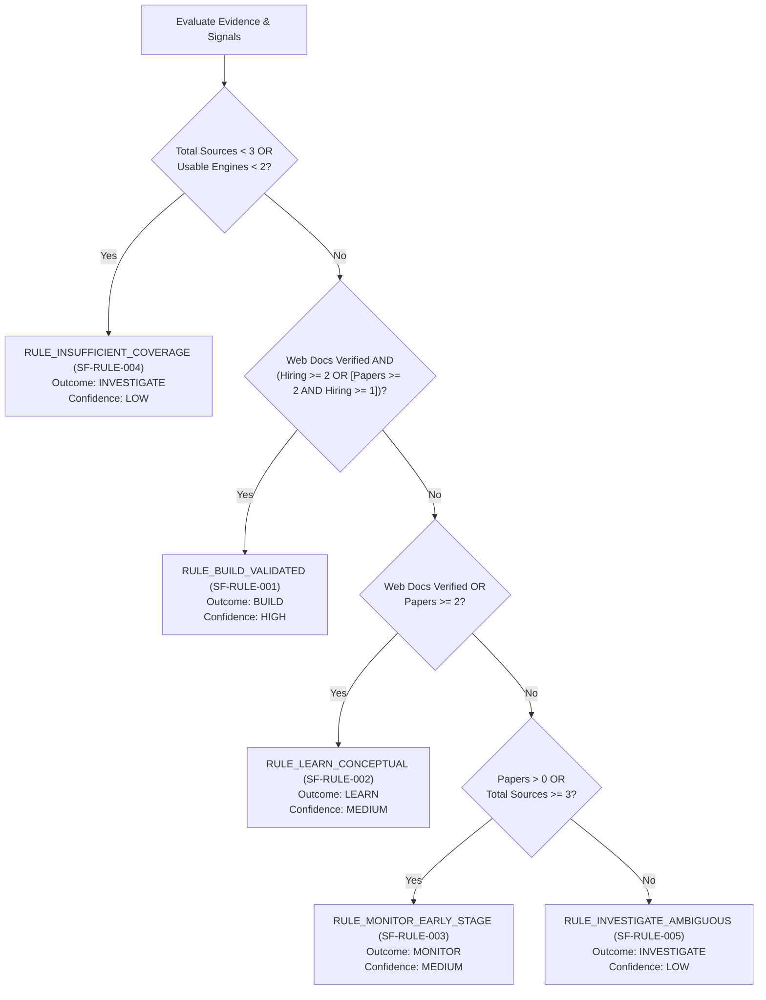

# SignalForge — Technical Architecture & System Specification

> **System Name:** SignalForge  
> **Document Version:** 1.0.0  
> **Target Platform:** Next.js 15 (App Router), TypeScript 5.7, Node.js v18.17+  
> **Status:** Implemented & Verified in Workspace

---

## 1. Document Purpose and Scope

This document specifies the technical architecture, data contracts, analytical algorithms, and operational boundaries of **SignalForge**. It is written for software engineers, architects, and technical evaluators who need to inspect, verify, maintain, or extend the system.

### Scope of Implementation
The specification reflects the actual codebase implemented in the current repository:
- **Presentation Layer:** Next.js 15 React Server and Client Components with Tailwind CSS.
- **API Orchestration Layer:** Server-side route handlers (`/api/research`, `/api/compare`, `/api/health`).
- **External Search Client:** Bounded HTTP integration with the SerpApi REST API across Google Search, Google Scholar, and Google Jobs.
- **Normalization & Analytics:** Heuristic URL deduplication, deterministic signal extraction, and rule-based decision logic.
- **Local Persistence & Export:** Process-local in-memory caching and browser `localStorage` research history.

---

## 2. System Context & Component Architecture

SignalForge operates across three primary physical boundaries: the client browser, the Next.js server runtime, and external search engine endpoints mediated by SerpApi.

```mermaid
flowchart TD
    subgraph Browser ["Client Boundary (Web Browser)"]
        UI_Search["Search & Topic Selector\n(src/components/SearchBox.tsx)"]
        UI_Card["Recommendation Banner\n(src/components/RecommendationCard.tsx)"]
        UI_Signals["Signal Grid\n(src/components/SignalCards.tsx)"]
        UI_Explorer["Evidence Explorer\n(src/components/EvidenceExplorer.tsx)"]
        UI_Compare["Comparison Radar\n(src/components/ComparisonView.tsx)"]
        UI_History["Local History Drawer\n(Browser localStorage)"]
    end

    subgraph ServerRuntime ["Next.js Server Runtime (Node.js)"]
        subgraph Routes ["HTTP Route Handlers"]
            R_Health["GET /api/health"]
            R_Research["POST /api/research"]
            R_Compare["POST /api/compare"]
        end

        subgraph Middleware_Services ["Core Engine Services"]
            Cache["In-Memory Cache Map\n(src/lib/cache.ts, TTL: 24h)"]
            Fixtures["Fixture Resolver\n(src/lib/fixtures.ts)"]
            SerpClient["SerpApi Client\n(src/lib/serpapi.ts, Timeout: 9s)"]
            Normalizer["URL Normalizer & Deduplicator\n(src/lib/serpapi.ts)"]
            Extractor["Signal Extractor\n(src/lib/signals.ts)"]
            DecisionEngine["Deterministic Decision Engine\n(src/lib/decision-engine.ts)"]
        end
    end

    subgraph ExternalSerpApi ["External SerpApi Platform"]
        API_Google["Google Search Engine\n(engine=google)"]
        API_Scholar["Google Scholar Engine\n(engine=google_scholar)"]
        API_Jobs["Google Jobs Engine\n(engine=google_jobs)"]
    end

    %% Client to Routes
    UI_Search -->|POST {technology, demo, refresh}| R_Research
    UI_Compare -->|POST {technologies, demo}| R_Compare
    UI_Search -.->|GET status| R_Health
    UI_History -.->|Re-open cached report| UI_Search

    %% Server Internal Flow
    R_Research --> Cache
    R_Research --> Fixtures
    R_Research --> SerpClient

    R_Compare --> Cache
    R_Compare --> SerpClient

    SerpClient -->|HTTPS + SERPAPI_KEY| API_Google
    SerpClient -->|HTTPS + SERPAPI_KEY| API_Scholar
    SerpClient -->|HTTPS + SERPAPI_KEY| API_Jobs

    API_Google -.-> SerpClient
    API_Scholar -.-> SerpClient
    API_Jobs -.-> SerpClient

    SerpClient --> Normalizer
    Normalizer --> Extractor
    Extractor --> DecisionEngine
    DecisionEngine --> R_Research

    %% Server to Client Responses
    R_Research --> UI_Card
    R_Research --> UI_Signals
    R_Research --> UI_Explorer
    R_Compare --> UI_Compare
```

---

## 3. Component Responsibilities

| Component / Module | Responsibility | Primary Inputs | Primary Outputs | Failure Behavior |
|---|---|---|---|---|
| **`src/app/page.tsx`** | Coordinates client UI state, active tabs, modal overlays, and history syncing. | User clicks, search inputs, API responses. | Rendered DOM tree. | Displays inline error banner if API returns non-200. |
| **`src/app/api/research/route.ts`** | Validates search inputs, coordinates cache lookups, triggers SerpApi calls, and assembles the `ResearchReport`. | `POST` JSON: `{ technology, demo, refresh }` | HTTP 200 `ResearchReport` or HTTP 400/500 error. | Returns HTTP 400 on invalid input length; returns `INVESTIGATE` on engine failure. |
| **`src/app/api/compare/route.ts`** | Orchestrates research retrieval for 2–3 technologies and generates comparative matrix. | `POST` JSON: `{ technologies: string[], demo }` | HTTP 200 `TechnologyComparison` or HTTP 400 error. | Rejects requests with fewer than 2 or more than 3 technologies with HTTP 400. |
| **`src/lib/serpapi.ts`** | Executes bounded HTTP requests to SerpApi, parses responses, calculates relevance, and deduplicates items. | Query string, target engine, server API key. | `NormalizedEngineResult` and `EvidenceItem[]`. | 9-second timeout via `AbortController`; returns `status: 'FAILED'` with error details. |
| **`src/lib/signals.ts`** | Extracts structured signals from normalized evidence across Hiring, Research, Web, and Temporal dimensions. | Normalized `EvidenceItem[]` and query name. | `ExtractedSignals` struct. | Produces zero-count signals with documented coverage limitations when evidence is missing. |
| **`src/lib/decision-engine.ts`** | Evaluates deterministic conditions (`SF-RULE-001` to `SF-RULE-005`) to assign action recommendations. | `EvidenceItem[]`, `ExtractedSignals`, engine status. | `RecommendationExplanation` struct. | Defaults to `INVESTIGATE` (`SF-RULE-004`) when evidence is sparse ($< 3$ items or $< 2$ engines). |
| **`src/lib/cache.ts`** | Stores complete research reports in process memory with a 24-hour time-to-live. | Normalized technology name, `ResearchReport`. | Cached `ResearchReport` with `mode: 'CACHED'`. | Returns `null` on cache miss or expired TTL; does not crash if memory is evicted. |
| **`src/lib/fixtures.ts`** | Provides high-fidelity, deterministic synthetic fixtures for demonstration and offline testing. | Normalized query string. | Pre-configured `ResearchReport` with `mode: 'DEMO FIXTURE'`. | Fallback clone with explanatory disclaimer if exact topic is not in registry. |
| **`src/lib/export.ts`** | Serializes reports and comparisons into GitHub Flavored Markdown. | `ResearchReport` or `TechnologyComparison`. | Formatted Markdown string. | Throws standard runtime error if report structure is malformed. |

---

## 4. End-to-End Request Lifecycle

### Request Sequence Diagram



### Exception & Edge-Case Handling

1. **Engine Timeout:** If an engine fails to respond within 9,000 ms, `AbortController` aborts the request. That specific engine receives `status: 'FAILED'` and `error: 'Request timed out after 9000ms.'`. Other engines complete normally.
2. **Partial Engine Failure:** If one or two engines fail (e.g., Google Scholar returns 0 items or times out), the workflow does not crash. Partial coverage is recorded in `enginesContacted`, and the decision engine factors the missing surfaces into its confidence assessment.
3. **Authentication Failure (HTTP 401):** The client maps the external error to `"SerpApi authentication error: Invalid or revoked API key."` and assigns `status: 'FAILED'`.
4. **Quota Depletion (HTTP 429 / Depleted message):** The client captures the quota failure message and records `status: 'FAILED'`. If all engines fail due to quota exhaustion, the report returns `INVESTIGATE` under Rule `SF-RULE-004` and refuses to cache the failed result.
5. **Zero Evidence Returned:** If a query yields zero sources across all three engines, the system returns `INVESTIGATE` with `RULE_INSUFFICIENT_COVERAGE` and bypasses the cache so future valid attempts are not blocked.

---

## 5. API Contracts

### 5.1 POST `/api/research`
Executes an empirical investigation for a single technology.

**Request Body:**
```json
{
  "technology": "Model Context Protocol",
  "demo": false,
  "refresh": false
}
```

| Field | Type | Required | Description |
|---|---|---|---|
| `technology` | `string` | Yes | Target technology name ($2 \le \text{length} \le 100$). |
| `demo` | `boolean` | No | If `true`, returns pre-validated synthetic demo fixtures without consuming API quota. Default: `false`. |
| `refresh` | `boolean` | No | If `true`, forces a fresh live SerpApi query, bypassing the 24-hour server cache. Default: `false`. |

**Successful Response (HTTP 200):**
```json
{
  "technology": "Model Context Protocol",
  "queryTimestamp": "2026-10-10T12:00:00.000Z",
  "executionTimeMs": 512,
  "mode": "LIVE",
  "totalSourcesExamined": 12,
  "deduplicatedSourcesCount": 12,
  "disclaimer": "Live research report retrieved via SerpApi. Signals and recommendations are computed deterministically from retrieved search observations and do not constitute investment or commercial advice.",
  "enginesContacted": [
    {
      "engine": "google",
      "status": "SUCCESS",
      "itemCount": 6,
      "durationMs": 480
    },
    {
      "engine": "google_scholar",
      "status": "SUCCESS",
      "itemCount": 2,
      "durationMs": 510
    },
    {
      "engine": "google_jobs",
      "status": "SUCCESS",
      "itemCount": 4,
      "durationMs": 490
    }
  ],
  "recommendation": {
    "outcome": "BUILD",
    "summary": "Evidence indicates that Model Context Protocol possesses both verified documentation/tooling and active industrial demand.",
    "supportingObservations": [
      "Official documentation verified: https://modelcontextprotocol.io/introduction.",
      "Identified 4 active hiring listing(s) at companies like: Nexus AI Labs, CloudScale."
    ],
    "contradictoryOrMissingEvidence": [
      "Temporal trend: Insufficient historical baseline data to compute growth velocity."
    ],
    "sourceCoverage": [
      {
        "engine": "google",
        "label": "Google Search",
        "status": "SUCCESS",
        "itemCount": 6,
        "note": "Successfully retrieved 6 items."
      }
    ],
    "exactRule": "RULE_BUILD_VALIDATED: Official documentation verified + Active employer hiring demand (>= 2 listings or >= 1 with research citations).",
    "ruleId": "SF-RULE-001",
    "evidenceToImproveConfidence": [
      "Review production post-mortems and benchmark latency/reliability under target workload."
    ],
    "confidenceLevel": "HIGH",
    "limitationDisclaimer": "A BUILD recommendation indicates observable technical activity and hiring presence, not financial return or market supremacy."
  },
  "signals": {
    "hiring": {
      "listingCount": 4,
      "companies": ["Nexus AI Labs", "CloudScale"],
      "locations": ["San Francisco, CA", "Bengaluru, India"],
      "skillKeywordsObserved": ["typescript", "python", "ipc"],
      "observations": ["Identified 4 active hiring listings."],
      "coverage": "Google Jobs search sample.",
      "limitations": ["Job listings reflect open requisitions at current snapshot."]
    },
    "research": {
      "paperCount": 2,
      "totalCitationsKnown": 20,
      "themesObserved": ["Standardized", "Security", "Evaluation"],
      "observations": ["Retrieved 2 scholarly papers."],
      "coverage": "Google Scholar indexed peer publications.",
      "limitations": ["Academic citation counts measure scientific interest."]
    },
    "web": {
      "hasOfficialDocumentation": true,
      "docOrRepoLinks": ["https://modelcontextprotocol.io/introduction"],
      "recentMentions": 6,
      "observations": ["Indexed 6 primary web resources."],
      "coverage": "Google Web Search organic indexing.",
      "limitations": ["Search visibility is influenced by SEO dynamics."]
    },
    "temporal": {
      "trendObservation": "Temporal trend: Insufficient historical baseline data to compute growth velocity.",
      "hasComparableHistoricalData": false,
      "limitations": ["Per SignalForge policy, growth percentages are never fabricated."]
    }
  },
  "evidence": [
    {
      "id": "ev-google-1728561600000-0",
      "technology": "Model Context Protocol",
      "sourceEngine": "google",
      "engineLabel": "Google Search",
      "title": "Model Context Protocol (MCP) Documentation",
      "snippet": "MCP is an open standard that enables developers to build secure, two-way connections...",
      "url": "https://modelcontextprotocol.io/introduction",
      "publishedAt": "2024-11-25",
      "retrievedAt": "2026-10-10T12:00:00.000Z",
      "evidenceType": "web",
      "relevanceScore": 0.98,
      "relevanceExplanation": "Exact technology subject match in primary title.",
      "sourceStatus": "LIVE",
      "limitations": ["Web search rankings reflect public indexing."]
    }
  ]
}
```

**Error Responses:**
- `400 Bad Request`: `{"error": "Technology search term must be at least 2 characters."}`
- `400 Bad Request`: `{"error": "Technology search term is too long (maximum 100 characters)."}`
- `500 Internal Server Error`: `{"error": "Internal server error parsing request: ..."}`

---

### 5.2 POST `/api/compare`
Compares 2 or 3 technologies across identical search surfaces.

**Request Body:**
```json
{
  "technologies": ["Model Context Protocol", "WebAssembly"],
  "demo": false
}
```

**Successful Response (HTTP 200):**
```json
{
  "technologies": ["Model Context Protocol", "WebAssembly"],
  "generatedAt": "2026-10-10T12:00:00.000Z",
  "matrix": [
    {
      "technology": "Model Context Protocol",
      "recommendation": "BUILD",
      "evidenceCount": 12,
      "webDocsFound": true,
      "hiringDemandObserved": true,
      "researchCitationsFound": true,
      "confidence": "HIGH",
      "keyLimitation": "Temporal trend: Insufficient historical baseline data to compute growth velocity."
    },
    {
      "technology": "WebAssembly",
      "recommendation": "BUILD",
      "evidenceCount": 16,
      "webDocsFound": true,
      "hiringDemandObserved": true,
      "researchCitationsFound": true,
      "confidence": "HIGH",
      "keyLimitation": "Established W3C standard since 2017."
    }
  ],
  "comparativeObservations": [
    "Model Context Protocol yielded 12 validated sources, resulting in a \"BUILD\" recommendation.",
    "WebAssembly yielded 16 validated sources, resulting in a \"BUILD\" recommendation."
  ],
  "coverageDiscrepancies": [],
  "limitations": [
    "Comparative radar highlights relative evidence availability across identical search engines.",
    "Disparities in search volume may stem from term naming specificity rather than real-world utility."
  ],
  "reports": {
    "Model Context Protocol": { "...": "Full ResearchReport" },
    "WebAssembly": { "...": "Full ResearchReport" }
  }
}
```

**Error Responses:**
- `400 Bad Request`: `{"error": "Comparison requires 2 or 3 distinct technologies."}`

---

### 5.3 GET `/api/health`
Returns system operational status and credential readiness.

**Response (HTTP 200):**
```json
{
  "status": "ok",
  "service": "SignalForge API",
  "version": "1.0.0",
  "hasSerpApiKey": true,
  "enginesConfigured": ["google", "google_scholar", "google_jobs"],
  "defaultMode": "LIVE",
  "disclaimer": "SignalForge deterministic technology opportunity radar. No secrets are exposed."
}
```

---

## 6. Evidence Data Model

The TypeScript model in `src/types/evidence.ts` enforces strict typing across the entire pipeline:

```typescript
export type SupportedEngine = 'google' | 'google_scholar' | 'google_jobs' | 'google_patents';
export type EvidenceType = 'web' | 'research' | 'hiring' | 'patent';
export type SourceStatus = 'LIVE' | 'CACHED' | 'DEMO FIXTURE';
export type RecommendationOutcome = 'LEARN' | 'BUILD' | 'MONITOR' | 'INVESTIGATE';

export interface EvidenceItem {
  id: string;
  technology: string;
  sourceEngine: SupportedEngine;
  engineLabel: string;
  title: string;
  snippet: string;
  url: string;
  publishedAt?: string;
  retrievedAt: string;
  evidenceType: EvidenceType;
  relevanceScore: number; // Normalized float 0.0 to 1.0
  relevanceExplanation: string;
  sourceStatus: SourceStatus;
  limitations: string[];
  metadata?: {
    authorOrPublisher?: string;
    citations?: number;
    companyName?: string;
    location?: string;
    filingDate?: string;
    patentNumber?: string;
    viaPlatform?: string;
  };
}
```

### Semantics of `SourceStatus`
- **`LIVE`**: The record was returned directly by an external SerpApi query during the current HTTP request cycle.
- **`CACHED`**: The record was retrieved from the server's in-memory cache, preserving the exact timestamp and evidence payload from the original live retrieval.
- **`DEMO FIXTURE`**: The record originates from synthetic demonstration fixtures. This mode is explicitly tagged in the UI to prevent synthetic data from being confused with live search results.

---

## 7. SerpApi Engine Integrations

SignalForge queries SerpApi via `https://serpapi.com/search.json` using three distinct engine parameters:

### 7.1 Google Search (`engine=google`)
- **Parameters Sent:** `engine=google`, `q=<technology>`, `api_key=<secret>`, `gl=us`, `hl=en`, `num=6`.
- **Fields Extracted:** `organic_results[].title`, `organic_results[].link`, `organic_results[].snippet`, `organic_results[].date`.
- **Classification:** Categorized as `evidenceType: 'web'`.
- **Normalization:** Extracted URLs are scrubbed of marketing and analytics tracking parameters.

### 7.2 Google Scholar (`engine=google_scholar`)
- **Parameters Sent:** `engine=google_scholar`, `q=<technology>`, `api_key=<secret>`, `gl=us`, `hl=en`, `num=6`.
- **Fields Extracted:** `organic_results[].title`, `organic_results[].link`, `organic_results[].snippet`, `publication_info.summary`, `inline_links.cited_by.total`.
- **Classification:** Categorized as `evidenceType: 'research'`.
- **Metadata Mapping:** `publication_info.summary` mapped to `metadata.authorOrPublisher`; `cited_by.total` parsed as an integer and mapped to `metadata.citations`.

### 7.3 Google Jobs (`engine=google_jobs`)
- **Parameters Sent:** `engine=google_jobs`, `q=<technology>`, `api_key=<secret>`, `gl=us`, `hl=en`, `num=6`.
- **Fields Extracted:** `jobs_results[].title`, `jobs_results[].company_name`, `jobs_results[].location`, `jobs_results[].via`, `jobs_results[].description`, `jobs_results[].share_link`.
- **Classification:** Categorized as `evidenceType: 'hiring'`.
- **Metadata Mapping:** `company_name` mapped to `metadata.companyName`; `location` mapped to `metadata.location`; `via` platform mapped to `metadata.viaPlatform`.

---

## 8. Normalization & Deduplication Algorithms

### URL Normalization (`normalizeUrl`)
Implemented in `src/lib/serpapi.ts`:
1. **URL Parsing:** Uses standard `new URL(rawUrl)`.
2. **Tracking Stripping:** Deletes `utm_source`, `utm_medium`, `utm_campaign`, `utm_content`, `utm_term`, and `ref`.
3. **Fragment Removal:** Strips `url.hash = ""`.
4. **Slash Sanitization:** Trims trailing slashes (`clean.replace(/\/+$/, "")`).

### Deterministic Deduplication (`deduplicateEvidence`)
Deduplication prevents the same resource from skewing signal metrics:
1. **URL Hash Set:** Tracks normalized URLs in a `Set<string>`. If a normalized URL has already been seen, subsequent duplicates are discarded.
2. **Title Collision Filter:** Computes an alphanumeric fingerprint (`title.toLowerCase().replace(/[^a-z0-9]/g, "")`). For titles exceeding 10 characters, identical title fingerprints from identical domains are discarded.
3. **Order Preservation:** Preserves the ranking order returned by the primary search engine.

---

## 9. Signal Extraction Methodology

The signal extractor in `src/lib/signals.ts` maps normalized sources into structured analytical signals:

### 9.1 Hiring Signal (`extractSignals().hiring`)
- **Listing Count:** Counts deduplicated items where `evidenceType === 'hiring'`.
- **Employer Discovery:** Aggregates unique company names from `item.metadata.companyName`.
- **Skill Keyword Scanning:** Scans job titles and snippets against a standard dictionary of technical skills:
  ```typescript
  const COMMON_TECH_SKILLS = [
    "python", "typescript", "javascript", "rust", "go", "golang", "c++",
    "docker", "kubernetes", "aws", "gcp", "azure", "linux", "sql", "nosql",
    "react", "next.js", "node.js", "graphql", "rest", "grpc", "ipc",
    "llm", "rag", "agents", "pytorch", "tensorflow", "vector", "parquet",
    "wasm", "wasi", "mcp", "olap", "arrow"
  ];
  ```
- **Limitations:** Explicitly notes that job listings reflect a point-in-time sample from indexed aggregators and do not represent a comprehensive census of total labor-market demand.

### 9.2 Research Signal (`extractSignals().research`)
- **Paper Count:** Counts deduplicated items where `evidenceType === 'research'`.
- **Citation Summation:** Sums integer values from `item.metadata.citations`. Missing citations are treated as zero rather than estimated.
- **Theme Extraction:** Tokenizes scholarly titles to isolate prominent technical themes (capitalized tokens $> 4$ characters).
- **Limitations:** Clarifies that academic citations measure scientific interest, which can precede or diverge from industrial production readiness.

### 9.3 Web Ecosystem Signal (`extractSignals().web`)
- **Official Documentation Matching:** Tests whether any web source URL contains documentation patterns (`docs`, `documentation`, `.io`, `.org`) or whether the title contains `"documentation"` or `"specification"`.
- **Repository Discovery:** Identifies GitHub or GitLab project repositories (`github.com`, `gitlab.com`).
- **Limitations:** Notes that search visibility is influenced by SEO dynamics and domain age.

### 9.4 Temporal Signal (`extractSignals().temporal`)
- **Integrity Rule:** Point-in-time search queries do not provide historical baselines. SignalForge refuses to fabricate growth curves or manufacture trend percentages.
- **Standard Output:**
  ```json
  {
    "trendObservation": "Temporal trend: Insufficient historical baseline data to compute growth velocity.",
    "hasComparableHistoricalData": false,
    "limitations": [
      "Search results capture point-in-time cross sections. True time-series trends require multi-quarter historical telemetry.",
      "Per SignalForge policy, growth percentages are never fabricated without verifiable historical snapshots."
    ]
  }
  ```

---

## 10. Decision Engine Specification

The deterministic decision engine in `src/lib/decision-engine.ts` evaluates evidence through five documented rules executed in strict precedence order:



### Rule Definitions

#### Rule `SF-RULE-004` (Precedence 1) — `RULE_INSUFFICIENT_COVERAGE`
- **Condition:** $\text{totalEvidenceCount} < 3 \lor \text{successfulEngines} < 2$
- **Outcome:** `INVESTIGATE`
- **Confidence:** `LOW`
- **Rationale:** Prevents hallucinated or speculative recommendations when the search surface yields sparse data.

#### Rule `SF-RULE-001` (Precedence 2) — `RULE_BUILD_VALIDATED`
- **Condition:** $\text{webDocFound} = \text{true} \land (\text{hiringCount} \ge 2 \lor (\text{paperCount} \ge 2 \land \text{hiringCount} \ge 1))$
- **Outcome:** `BUILD`
- **Confidence:** `HIGH`
- **Rationale:** Technology possesses verified documentation/tooling and observable industrial hiring demand. Suitable for bounded prototyping.

#### Rule `SF-RULE-002` (Precedence 3) — `RULE_LEARN_CONCEPTUAL`
- **Condition:** $\text{webDocFound} = \text{true} \lor \text{paperCount} \ge 2$
- **Outcome:** `LEARN`
- **Confidence:** `MEDIUM`
- **Rationale:** Documentation or academic backing is verified, but industrial hiring remains nascent ($< 2$ listings). High educational and sandbox value.

#### Rule `SF-RULE-003` (Precedence 4) — `RULE_MONITOR_EARLY_STAGE`
- **Condition:** $\text{paperCount} > 0 \lor \text{totalEvidenceCount} \ge 3$
- **Outcome:** `MONITOR`
- **Confidence:** `MEDIUM`
- **Rationale:** Early mentions or academic interest exist, but primary production documentation or hiring presence is unverified. Recommended for passive tracking.

#### Rule `SF-RULE-005` (Precedence 5) — `RULE_INVESTIGATE_AMBIGUOUS`
- **Condition:** Fallback if conditions for Rules 1–3 are not met.
- **Outcome:** `INVESTIGATE`
- **Confidence:** `LOW`
- **Rationale:** Signals are conflicting or ambiguous; domain-specific manual verification is required.

---

## 11. Cache & Quota Management

SignalForge is designed for a solo developer quota allowance of **250 searches per month**:

- **Cache Implementation:** Process-local `Map<string, CacheEntry<ResearchReport>>` in `src/lib/cache.ts`.
- **Cache Key:** Derived from the normalized query string: `report:${technology.trim().toLowerCase()}`.
- **Time-to-Live (TTL):** 24 hours (`86,400,000` ms). Repeated queries within this window consume zero SerpApi calls.
- **Forced Refresh:** Passing `refresh: true` in `POST /api/research` bypasses the cache and queries SerpApi directly.
- **Error Protection:** Empty or failed responses are never cached.
- **Process Boundary:** The cache is memory-based. Restarting the server process resets the cache.

---

## 12. Security & Trust Boundaries

1. **Server-Side Credential Isolation:**
   - `SERPAPI_KEY` is loaded strictly via `process.env.SERPAPI_KEY`.
   - Never exposed to browser JavaScript, client environment variables (`NEXT_PUBLIC_*`), or HTML attributes.
2. **Version Control Safety:**
   - `.env` and `.env.local` are explicitly listed in `.gitignore`.
   - Automated git checks verify that no secret files are staged or committed.
3. **Input Sanitization:**
   - Input strings are validated for length ($2 \le \text{length} \le 100$) to prevent URL query injection or resource exhaustion.
4. **Untrusted Content Handling:**
   - Search result snippets, job titles, and academic abstracts are treated as untrusted text data and rendered using React's default text escaping.
5. **Safe Outbound Navigation:**
   - Outbound links to original search results use `target="_blank"` with `rel="noopener noreferrer"` to prevent tab-nabbing vulnerabilities.

---

## 13. Testing Strategy

The repository includes automated unit tests implemented with **Vitest**:

```bash
npm test
```

### Test Coverage Overview
- **`tests/serpapi.test.ts`**: Verifies URL normalization, tracking parameter stripping, deterministic relevance scoring, duplicate URL removal, and API key secrecy.
- **`tests/signals.test.ts`**: Verifies hiring employer extraction, skill dictionary matching, scholarly citation summation, and the anti-fabrication temporal policy.
- **`tests/decision-engine.test.ts`**: Tests deterministic rule evaluation for `BUILD` (`SF-RULE-001`), `LEARN` (`SF-RULE-002`), and `INVESTIGATE` (`SF-RULE-004`).
- **`tests/export.test.ts`**: Verifies structured Markdown export generation for research reports and multi-technology comparisons.

---

## 14. Architectural Decisions and Trade-offs

| Decision | Rationale | Trade-off | Revisit When |
|---|---|---|---|
| **Next.js App Router** | Unified full-stack framework with built-in API routes, TypeScript support, and zero separate backend services. | Server-side state is tied to the Next.js Node process. | A dedicated microservice architecture is required. |
| **Deterministic Rule Engine over LLM** | Guarantees auditable, reproducible, zero-hallucination recommendations without requiring an additional paid AI API key. | Cannot generate free-form conversational prose or interpret ambiguous synonyms. | Complex semantic disambiguation is required. |
| **Process-Local In-Memory Cache** | Zero infrastructure dependencies (no Redis or PostgreSQL setup required). | Cache does not persist across server restarts or distribute across multi-instance clusters. | Multi-instance load-balanced production scaling is introduced. |
| **Client LocalStorage for History** | Zero authentication friction; users can save and revisit investigations instantly. | History is device-specific and does not sync across multiple browsers or workstations. | Multi-user collaboration or team accounts are required. |
| **Transparent Demo Fixture Mode** | Evaluators and judges can test the full user experience without needing a SerpApi API key or consuming quota. | Demo mode reflects fixed synthetic topics rather than arbitrary live queries. | Universal evaluation access is no longer needed. |

---

## 15. Known Limitations & Future Considerations

### Current Limitations
1. **Single-Instance Cache:** The in-memory cache is local to the Node.js process and will not synchronize across a horizontal cluster.
2. **Aggregator Lag:** Job postings and scholarly citations depend on Google's indexing crawl schedule; recent changes may lag by days or weeks.
3. **Language & Region:** The search client defaults to `gl=us` and `hl=en`. Regional queries in other languages may require explicit query tuning.

### Future Architecture Considerations
- **Distributed Cache:** Replace the in-memory map with a Redis or Upstash key-value store.
- **Domain Registries Integration:** Supplement SerpApi search results with direct registry telemetry from PyPI, npm, and crates.io.
- **Optional Local LLM Explainer:** Add an optional, locally hosted model (e.g., via Ollama) to synthesize prose summaries from verified evidence items without altering the deterministic decision outcome.
